# Bebebus Live Beauty SDK 技术架构说明

本文档说明 **Bebebus Live Beauty SDK** 的端侧实时图形渲染管线、微分同胚面部微整数学模型、质感磨皮与毛发高频保护机制，以及跨平台确定性验证门禁。

---

## 1. 设计目标

1. **与推流 / RTC 引擎彻底解耦**：
   - Android 端仅以标准 OpenGL ES 2.0 `GL_TEXTURE_2D` 纹理与时间戳作为输入输出（`LiveBeautyProcessor.process(inputTexture, width, height, timestampNs)`），不绑定任何特定推流器或相机框架，可直接串联 WebRTC、Agora（声网）、Zego（即构）、Tencent TRTC、CameraX、MediaCodec 或自研采集管线。
   - iOS 端基于 `CoreImage` + `CVPixelBufferPool` 零拷贝复用，支持 `CMSampleBufferRef` 采集回调与 `CIImage` 滤镜链两种接入形态。
2. **零背景扭曲、零轮廓残影、左右对称守恒**：
   - 传统基于图像空间高斯圆盘（MLS / 局部液化）的瘦脸方案极易把衣领、门框及胡须外缘一并拉弯，并在转头时造成远近脸不对称或侧脸轮廓重影。
   - 本 SDK 采用 **548 顶点 / 1086 三角形受约束网格**，结合 **2D 平顶纯剪切场（Pure-Shear Plateau）**、**Boltzmann 加权软上确界对称化**、**面内几何偏航角估计** 与 **跨帧松弛因子均衡门控**，在严格保证背景零位移的同时消除轮廓重影与大小脸。
3. **保留原生肤质与胡须/眉睫毛流**：
   - 采用 1080p 导向滤波（Guided Filter）与高频微纹理回注，配合 `HairSegmenter` + `SelfieSegmenter` 掩码门控，防止胡须边缘出现“粘皮感”或涂抹感。

---

## 2. Android OpenGL ES 渲染管线拓扑

```mermaid
flowchart LR
    Cam["输入纹理 GL_TEXTURE_2D (竖屏正立 RGBA)"] --> Track["异步推理工作线程 (MediaPipe 478 点人脸 / 33 点人体 / 人像分割 / 头发分割)"]
    Cam --> Ring["FrameDelayRing 零滞后帧对齐缓冲"]
    Track --> Smooth["时间域自适应平滑 (MeshLandmarkSmoother + MaskTemporalSmoother)"]
    Ring --> Bokeh["背景虚化 (Portrait Bokeh)"]
    Smooth --> Bokeh
    Bokeh --> Body["5 轴人体微整网格 (BodyMeshDeformer)"]
    Body --> Face["14 项 478 点微分同胚面部网格 (FaceMeshDeformer)"]
    Face --> Guided["1080p 导向滤波磨皮 + 微纹理保留 + 胡须/毛发高频保护 (GuidedSkinSmoothPass)"]
    Guided --> Local["局部精修 (祛斑 / 淡法令纹 / 去黑眼圈 / 亮眼 / YCbCr 白牙)"]
    Local --> Makeup["6 层 UV 实时美妆与双眼神光 (FaceMakeupPass)"]
    Makeup --> Color["肤色美白红润 + 柔光立体打光 + 64³ 3D LUT (LutLoader)"]
    Color --> Denoise["低光自适应补偿 + 时域降噪 (TemporalDenoisePass)"]
    Denoise --> Out["输出纹理 GL_TEXTURE_2D"]
```

---

## 3. 核心算法要点

### 3.1 478 点 $C^\infty$ 微分同胚面部网格（`FaceMeshDeformer`）
- **双环外扩锚定边界**：在 MediaPipe 468 个标准拓扑点之外，实时沿头部外轮廓法向向外生成两圈带状缓冲环（共 `548` 顶点、`1086` 三角形），最外圈位移恒锁死为 `(0, 0)`，物理隔离背景区域。
- **2D 平顶纯剪切轮廓场（`evalContour2D`）**：瘦脸、V 脸、窄脸、瘦颧骨在面内正交基底 $(\hat{r}, \hat{u})$ 上计算位移，横向采用 4 阶超高斯平顶包络 $1 / (1 + \tilde{x}^4)$，使颊侧高曲率窄条三角形整体刚体平移而不发生面内弯曲折叠，消除侧脸轮廓双影。
- **Boltzmann 加权软上确界对称宽度（`softMaxSpan`）**：以指数加权均值估计左右半脸跨度，避免透视缩短侧的耳前锚点因单点 `max` 跳变而导致左右收缩量失衡。
- **最小松弛因子均衡（`limitVertices`）**：当大角度快速转头触发雅可比行列式安全限幅（防止三角面片翻转 $J < J_{\min}$）时，对共享极薄边缘三角形的相邻轮廓顶点取最小松弛系数同步缩放，避免内外边缘错速产生阶梯状撕裂。

### 3.2 质感磨皮与毛发边界保护（`GuidedSkinSmoothPass`）
- 在半分辨率提取光照导向低频层，全分辨率回注高频毛孔微纹理（`skinTexture`），通过高频能量自适应门控压制痘印瑕疵同时保留眉眼唇锐度与男性胡须毛流。

### 3.3 帧延迟对齐与三级负载治理
- **`FrameDelayRing`**：将相机纹理缓存 1~2 帧，使当前渲染帧与异步 MediaPipe 推理产出的几何/分割掩码精确对齐同一采集时刻，消除快速运动时的“五官追脸”拖影。
- **`BeautyLoadGovernor` & `BitrateEffectsTuning`**：实时监测 GPU 帧耗时与编码器码率压力比（`bitrateRatio`），超预算时按三级阶梯平滑降载（先降分割频率，再关重度通道，极端低端机回退零拷贝原画直通），弱网拥塞时自动降低锐化并提升时域降噪权重以节省码率。

---

## 4. 跨平台黄金向量与无头 GPU 验证门禁

| 门禁 | 位置 | 验证内容 |
| --- | --- | --- |
| 开源脱敏扫描 | `_tooling/sanitize-check.py` | 扫描全仓源码与配置，杜绝业务包名、私有域名与本机绝对路径残留 |
| 离线模型校验 | `_tooling/verify-models.py` | 校验全部 5 份内置 `.task` / `.tflite` 模型体积与 SHA-256 指纹 |
| 拓扑一致性门禁 | `reference/gen_face_topology.py --verify` | 校验 `FaceMeshTopology.kt` 与标准 468/548 顶点拓扑逐字节一致 |
| WebGL1 GLSL 像素门禁 | `_tooling/glsl/glsl_gate.py` | 启动无头 Chrome 真编译全部 41 段 GLSL 着色器，执行 27 组变异注入测试与像素探针 |
| 3D LUT 像素校验 | `reference/gen_builtin_luts.py --verify` | 校验全部 10 张 `512×512`（`64^3`）内置 LUT PNG 恒等性与单调性 |
| iOS/macOS CoreImage 门禁 | `ios/Tests/verify_macos_ci.m` | 编译全部 Objective-C 类，在 Metal GPU 上渲染合成帧并校验 150ms 渐入平滑器 |
| Android & Flutter 单测 | `android/` & `flutter/` | 运行 34 套 Kotlin Debug/Release JVM 单测、构建独立 Release AAR，并执行 `flutter analyze` 与 `flutter test` |
