# Bebebus Live Beauty SDK 技术架构说明

本文档说明 **Bebebus Live Beauty SDK** 的端侧实时图形渲染管线、微分同胚面部微整数学模型、质感磨皮与毛发高频保护机制，以及跨平台确定性验证门禁。

---

## 1. 设计目标

1. **与推流 / RTC 引擎彻底解耦**：
   - Android 端仅以标准 OpenGL ES 2.0 `GL_TEXTURE_2D` 纹理与时间戳作为输入输出（`LiveBeautyProcessor.process(inputTexture, width, height, timestampNs)`），不绑定任何特定推流器或相机框架，可直接串联 WebRTC、Agora（声网）、Zego（即构）、Tencent TRTC、CameraX、MediaCodec 或自研采集管线。
   - iOS 端基于 `CoreImage` + `CVPixelBufferPool` 零拷贝复用，支持 `CMSampleBufferRef` 采集回调与 `CIImage` 滤镜链两种接入形态。
2. **零背景扭曲、零轮廓残影、左右对称守恒**：
   - 传统基于图像空间高斯圆盘（MLS / 局部液化）的瘦脸方案极易把衣领、门框及胡须外缘一并拉弯，并在转头时造成远近脸不对称或侧脸轮廓重影。
   - 本 SDK 采用 **548 顶点 / 1086 三角形受约束网格**，结合 **2D 平顶纯剪切场（Pure-Shear Plateau）**、**Boltzmann 加权软上确界对称化**、**面内几何偏航角估计** 与 **跨帧松弛因子均衡门控**，在严格保证背景零位移的同时消除轮廓重影与大小脸。
3. **保留原生肤质与胡须/眉睫毛流**：
   - 采用 1080p 导向滤波（Guided Filter）与高频微纹理回注，配合 `HairSegmenter` + `SelfieSegmenter` 掩码门控，防止胡须边缘出现“粘皮感”或涂抹感。

---

## 2. Android OpenGL ES 渲染管线拓扑

```mermaid
flowchart LR
    Cam["输入纹理 GL_TEXTURE_2D (竖屏正立 RGBA)"] --> Roi["远景自适应 1:1 ROI + GLES 3.0 双 PBO 零阻塞回读 (FaceRoiSelector + FaceTextureSampler)"]
    Roi --> Track["异步推理工作线程 (MediaPipe 478 点人脸 / 33 点人体 / 人像分割 / 头发分割)"]
    Cam --> Ring["FrameDelayRing 零滞后帧对齐缓冲"]
    Track --> Smooth["时间域自适应平滑 (MeshLandmarkSmoother + MaskTemporalSmoother)"]
    Ring --> Bokeh["背景虚化 (Portrait Bokeh)"]
    Smooth --> Bokeh
    Bokeh --> Body["5 轴人体微整网格 (BodyMeshDeformer)"]
    Body --> Face["15 项 478 点微分同胚面部与高颅顶网格 (FaceMeshDeformer)"]
    Face --> Retouch["468 点解剖子网格原位精修：留卧蚕黑眼圈 / 弧线法令纹 / 眼裂亮眼 / 防染唇白牙 (FaceRetouchMeshPass)"]
    Retouch --> Guided["双频奶油肌匀肤 (1/3 导向滤波 + 1/9 宏尺度匀光) + 微纹理保留 + 胡须保护 (GuidedFilterPrePass)"]
    Guided --> Makeup["6 层 UV 实时美妆与双眼神光 (FaceMakeupPass)"]
    Makeup --> Color["肤色美白红润 + 柔光立体打光 + 64³ 3D LUT + 主合成 (FRAGMENT_PRO)"]
    Color --> Denoise["低光自适应补偿 + 时域降噪 (TemporalDenoisePass)"]
    Denoise --> Out["输出纹理 GL_TEXTURE_2D"]
```

---

## 3. 核心算法要点

### 3.1 478 点 $C^\infty$ 微分同胚面部与高颅顶网格（`FaceMeshDeformer`）
- **双环外扩锚定边界**：在 MediaPipe 468 个标准拓扑点之外，实时沿头部外轮廓法向向外生成两圈带状缓冲环（共 `548` 顶点、`1086` 三角形），最外圈位移恒锁死为 `(0, 0)`，物理隔离背景区域。
- **2D 平顶纯剪切轮廓场（`evalContour2D`）**：瘦脸、V 脸、窄脸、瘦颧骨在面内正交基底 $(\hat{r}, \hat{u})$ 上计算位移，横向采用 4 阶超高斯平顶包络 $1 / (1 + \tilde{x}^4)$，使颊侧高曲率窄条三角形整体刚体平移而不发生面内弯曲折叠，消除侧脸轮廓双影。
- **高颅顶 / 蓬松头包脸（`cranialTop`）**：仅对外层中环颅顶与上颞发冠缓冲顶点施加沿头轴向上的外蓬位移，保持裸额头发际线（顶点 `10`）不被向上拉长，且外环锚点位移严格为 `(0, 0)`，天花板与门框直线零弯曲。
- **Boltzmann 加权软上确界对称宽度（`softMaxSpan`）**：以指数加权均值估计左右半脸跨度，避免透视缩短侧的耳前锚点因单点 `max` 跳变而导致左右收缩量失衡。
- **最小松弛因子均衡（`limitVertices`）**：当大角度快速转头触发雅可比行列式安全限幅（防止三角面片翻转 $J < J_{\min}$）时，对共享极薄边缘三角形的相邻轮廓顶点取最小松弛系数同步缩放，避免内外边缘错速产生阶梯状撕裂。

### 3.2 双频奶油肌匀肤与毛发边界保护（`GuidedFilterPrePass`）
- **中频 `1/3` 导向滤波 + 低频 `1/9` 宏尺度肤色匀光**：`1/3` 分辨率保边导向滤波消除小面积痘印与粗大毛孔阴影，叠加 `1/9` 分辨率宏尺度匀光抚平 `18–40 px` 泪沟暗沉、鼻翼泛红与口周色块；通过 `boneKeep` 立体骨相光比门控与 `flatKeep` 边缘门控保护鼻梁/苹果肌/下颌高光阴影，并在全分辨率回注 `2–4 px` 原生毛孔微纹理与男性胡须毛流，同时将宏尺度匀光折叠进导向滤波截距项 `(1 - a) * evenMean`，使主合成 `FRAGMENT_PRO` 活跃 uniform 严守 `15` 个以内。

### 3.3 468 点解剖子网格原位精修（`FaceRetouchMeshPass`）
- 在变形后网格绑定的同一张 FBO 上直接按 MediaPipe 468 点真实解剖拓扑光栅化局部精修，省去整张 `1080×1920` 全屏中间 FBO 拷贝：
  - **去黑眼圈留卧蚕**：避开紧贴下睑缘 `2–4 mm` 的卧蚕高光带（`AEGYO_SAL_PROTECTED_SET`），精准提亮下方泪沟眼袋凹陷并中和青紫暗沉。
  - **弧线贴合法令纹**：沿鼻翼基底—口角外侧—木偶纹上段 4 段弯曲折线计算软距离羽化，取代粗糙直线胶囊。
  - **28 眼裂亮眼 & 18 内唇孔洞白牙**：仅在上下眼睑围合的眼裂三角形内提亮巩膜并增强虹膜通透度；仅在 `INNER_MOUTH_INDICES` 内唇孔洞三角形内执行 YCbCr 黄度门控白牙，物理杜绝白牙溢出染灰嘴唇。

### 3.4 远景自适应 ROI 跟踪与 GLES 3.0 双 PBO 异步回读（`FaceRoiSelector` + `FaceTextureSampler`）
- **远景小脸自适应 `1:1` ROI**：当半身/站立/舞蹈直播人脸宽度占比 `<= 0.30`（退出迟滞阈值 `0.36`）时，自动围绕上一帧人脸中心裁剪 `2.2×` 尺度的正方形区域缩放到 `256×256` 送入 MediaPipe FaceLandmarker，推理后精确线性反投影回全画幅坐标；单帧漏检立即回退全幅采样，杜绝目标丢失死锁。
- **OpenGL ES 3.0 双 PBO 硬件 DMA 回读**：运行时自动检测 GLES 3.0+ 上下文，使用双缓冲 `GL_PIXEL_PACK_BUFFER` 交替发起异步回读与上一帧 `glMapBufferRange` CPU 映射，消除主渲染线程 `glReadPixels` 同步管线停顿；纯 GLES 2.0 设备自动无感回退同步路径。

### 3.5 帧延迟对齐与三级负载治理
- **`FrameDelayRing`**：将相机纹理缓存 1~2 帧，使当前渲染帧与异步 MediaPipe 推理产出的几何/分割掩码精确对齐同一采集时刻，消除快速运动时的“五官追脸”拖影。
- **`BeautyLoadGovernor` & `BitrateEffectsTuning`**：实时监测 GPU 帧耗时与编码器码率压力比（`bitrateRatio`），超预算时按三级阶梯平滑降载（先降分割频率，再关重度通道，极端低端机回退零拷贝原画直通），弱网拥塞时自动降低锐化并提升时域降噪权重以节省码率。

---

## 4. 跨平台黄金向量与无头 GPU 验证门禁

| 门禁 | 位置 | 验证内容 |
| --- | --- | --- |
| 开源脱敏扫描 | `_tooling/sanitize-check.py` | 扫描全仓源码与配置，杜绝业务包名、私有域名与本机绝对路径残留 |
| 离线模型校验 | `_tooling/verify-models.py` | 校验全部 5 份内置 `.task` / `.tflite` 模型体积与 SHA-256 指纹 |
| 拓扑一致性门禁 | `reference/gen_face_topology.py --verify` | 校验 `FaceMeshTopology.kt` 与标准 468/548 顶点拓扑逐字节一致 |
| WebGL1 GLSL 像素门禁 | `_tooling/glsl/glsl_gate.py` | 启动无头 Chrome 真编译全部 44 段 GLSL 着色器，执行 28 组变异注入测试与像素探针 |
| 3D LUT 像素校验 | `reference/gen_builtin_luts.py --verify` | 校验全部 10 张 `512×512`（`64^3`）内置 LUT PNG 恒等性与单调性 |
| iOS/macOS CoreImage 门禁 | `ios/Tests/verify_macos_ci.m` | 编译全部 Objective-C 类，在 Metal GPU 上渲染合成帧并校验 150ms 渐入平滑器 |
| Android & Flutter 单测 | `android/` & `flutter/` | 运行 36 套 Kotlin Debug/Release JVM 单测、构建含双架构 `liblivebeauty_jni.so` 的独立 Release AAR，并执行 `flutter analyze` 与 `flutter test` |
| C++17 统一内核与 Metal 像素门禁 | `core/tests/` | 零外部依赖 CTest 套件：验证 548 顶点微分同胚/高颅顶/时间线/ROI/负载治理（`livebeauty_math_tests`）、Mock RHI 8 大 Pass 拓扑与零反馈环（`livebeauty_rhi_tests`）及 macOS 真实 Metal GPU 像素门禁 `L1/L2/L6`、`E1–E4`、`R1` 与端到端渲染（`livebeauty_metal_pixel_gate`） |

---

## 5. 统一 C++17 渲染与数学内核（`core/`）

自 `v2.0` 架构演进起，SDK 将全部核心数学模型、渲染编排与图形后端收口为三层零重型依赖的 C++17 模块（详见 [docs/cpp-core-architecture-plan.md](./docs/cpp-core-architecture-plan.md)）：

1. **纯数学与状态机核（`livebeauty_math`）**：`FaceMeshTopology`（由 `reference/gen_face_topology.py` 与 Kotlin 逐字节同源生成）、`FaceMeshDeformer`（15 轴 $C^\infty$ 微分同胚 + 高颅顶）、`FaceMeshFilter`、`FaceTimeline`、`FaceRoiSelector`、`FaceMakeupUv`、`FaceRetouchSubMesh`、`BodyGeometry` 与 `EffectsLoadGovernor`。
2. **跨后端轻量 RHI 与 RenderGraph 编排器（`livebeauty_engine`）**：`IRhiDevice` + `RenderPipeline` + `LiveBeautyEngine`，统一管理全 8 大 Pass 调度顺序、画家序背面剔除、FBO 复用池与反馈环隔离。
3. **双原生图形后端**：
   - **Android（`livebeauty_gles` + `livebeauty_jni`）**：OpenGL ES 2.0/3.0 + 精调 GLSL 着色器 + NDK/JNI 桥接（`arm64-v8a` / `armeabi-v7a` 双架构 `.so` 自动打包进 AAR）；
   - **iOS / macOS（`livebeauty_metal` + `FLTLiveBeautyMetalEngine`）**：Apple Metal + 等价精调 MSL 着色器 + `CVMetalTextureCache` 零拷贝桥接，使 iOS 端与 Android 满血能力全面对齐。
